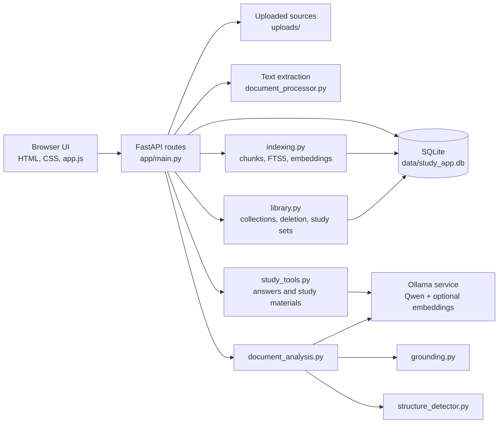

# Study Desk codebase guide

This guide explains how the current app is organized and how a document moves through it. The app is a small local FastAPI service with a plain HTML/CSS/JavaScript front end, SQLite storage, and Ollama for local language-model and embedding requests.

## 1. Run the app

From the project folder on Windows:

```powershell
.\.venv\Scripts\python.exe -m uvicorn app.main:app --host 127.0.0.1 --port 8000
```

Or double-click `run_study_app.bat`. The browser UI is at `http://127.0.0.1:8000`; FastAPI’s API reference is at `/docs`.

The server binds to loopback, so it is intended for use on the same computer. Do not change the bind host to `0.0.0.0` unless network access is intended.

## 2. Architecture at a glance



The browser calls the local API with `fetch`. The API stores document and study records in SQLite and source files in `uploads/`. Model calls go through `app/ollama.py`; the app has no remote web-service dependency for its study flows.

## 3. Project structure

| Path | Responsibility |
|---|---|
| `app/main.py` | FastAPI app, startup/schema-version check, request models, API routes, request validation and error mapping. |
| `app/database.py` | SQLite connection, base tables, document/page storage, analyses, and hash-based document lookups. |
| `app/document_processor.py` | Extract selectable text from PDF and DOCX files. Image-only PDFs are unsupported. |
| `app/indexing.py` | Page chunking, FTS5 indexing, embedding reuse/creation, retrieval, progress, and representative sampling. |
| `app/study_tools.py` | Grounded Q&A, flashcards, quizzes, study guides, concept maps, source-ID validation, and quiz text cleanup. |
| `app/library.py` | Library listing, duplicate relationships, collections, registration of existing uploads, deletion, and saved study materials. |
| `app/backup_restore.py` | Library ZIP creation, archive/path checks, database validation, safety backup, and restore. |
| `app/ollama.py` | Ollama connection, configured model status, chat generation, and embeddings. |
| `app/document_analysis.py` | Multi-stage document and chapter analysis. Uses grounding/structure helpers and saves analysis results. |
| `app/grounding.py` | Source passage preparation, grounding instructions, and citation/source validation helpers for analysis. |
| `app/structure_detector.py` | Detects document structure and chapter/section boundaries for analysis. |
| `app/static/index.html` | Page structure and interface content. |
| `app/static/app.js` | Browser state, API calls, view switching, upload/index flows, study-tool interactions, rendering, and notices. |
| `app/static/styles.css` | Base visual rules and common layout. |
| `app/static/front-page.css` | Library landing/hero styles. |
| `app/static/library-list.css` | Document row and collection-list refinements. |
| `app/static/polish.css` | Later responsive, accessibility, and study-material styling overrides. |
| `app/migrate_database.py` and `app/migrate_database_v*.py` | Versioned SQLite migrations and pre-migration backup checks. |
| `requirements.txt` | Python runtime dependencies. |
| `run_study_app.bat` | Windows launcher using the project virtual environment and Uvicorn reload. |
| `data/study_app.db` | Local database. |
| `data/backups/` | Migration, pre-delete, and library backup files. |
| `uploads/` | Original uploaded PDF and DOCX files. |

## 4. Main data flow

### Add a document

1. `app.js` sends a PDF/DOCX upload to `POST /api/upload-document`.
2. `main.py` enforces the 20 MB limit and hashes the raw upload bytes.
3. `get_document_by_source_hash` can identify an exact file before extraction.
4. If the file is new, `document_processor.extract_text` reads page text.
5. `main.py` hashes extracted text to detect equivalent-content duplicates.
6. New files are moved to a UUID-based name in `uploads/`; `save_document` stores the record and extracted pages in SQLite.

### Index and search

1. `POST /api/documents/{id}/index` calls `indexing.index_document`.
2. Page text is split into chunks of up to 1,500 characters with 180 characters of overlap.
3. Chunks are indexed in FTS5. If Ollama’s embedding model is available, missing vectors are created in batches of 16.
4. Matching content hash and chunker version allow saved chunks/embeddings to be reused.
5. `POST /api/search` searches selected chunks with FTS5 and, when embeddings are present, semantic similarity. Results are combined and include filenames, page ranges, and excerpts.
6. `sample_chunks` selects passages across the selected documents for general study-material generation when no focus topic is entered.

### Ask a question

1. The browser sends the question and selected scope to `POST /api/ask`.
2. `main.py` resolves the selected documents/collection and calls `search_chunks`.
3. `study_tools.answer_question` builds a prompt from the retrieved passages and asks the configured Ollama text model.
4. Citation IDs and page ranges are checked against the supplied source passages. The API returns the answer, sources, retrieval mode, and any citation warning.
5. The browser renders the answer and clickable source-page links.

### Generate a study set

1. The browser sends `material_type`, focus topic, scope, and quiz options to `POST /api/study-materials/generate`.
2. Topic-focused requests use search results; otherwise the app samples passages across the selected scope.
3. `study_tools.py` prompts the local model and validates item shapes and source IDs. Quiz question text is cleaned of internal labels such as `S3` before it is shown.
4. Quiz sets can contain multiple-choice, short-answer, or fill-in-the-blank items. A chosen set of 15–50 is generated in batches of up to 10 to limit output truncation and avoid repeated stems.
5. `library.save_study_material` stores the full set, scope, source references, and type in `study_materials`.
6. `GET /api/study-materials` loads saved sets; delete uses `DELETE /api/study-materials/{id}`.

### Delete and recover

- Document deletion creates and checks a SQLite pre-delete backup, removes the document’s database/index references, removes study sets that depend on it, and deletes its upload only if another record does not share it.
- A downloadable library ZIP contains the database, uploaded files, and manifest. Restore validates the archive, stages the replacement, creates a safety backup of the current library, then replaces the data.

## 5. Main database records

The schema starts in `database.init_db()` and is extended by the migration scripts.

| Table/group | What it stores |
|---|---|
| `documents` | File metadata, extracted full text, content hash, and raw source-file hash. |
| `document_pages` | Page-level extracted text for citations and indexing. |
| `document_chunks`, `chunk_fts` | Searchable chunks and SQLite full-text index rows. |
| `chunk_embeddings` | Optional local embedding vectors keyed to chunks and embedding model. |
| `processing_runs`, `processing_run_chunks` | Indexing progress, configuration, and chunk-level status. |
| `collections`, `collection_documents` | User-created groups and their document assignments. |
| `document_duplicates` | Links duplicate records to a canonical record. |
| `study_materials` | Saved flashcards, quizzes, study guides, and concept maps as JSON. |
| `document_analyses`, `chapter_analyses` | Saved whole-document and chapter-level analysis. |
| `schema_migrations` | Applied schema version and description. |

Folder-related tables may remain from the original migration history, but folders are not part of the current user interface. Collections are the active grouping feature.

## 6. Database migrations

The current copied database is migration version **5**. On startup, `main.py` checks that the latest version is at least 5.

For an empty database, initialize the base schema and apply migrations in order as listed in the root `README.md`:

1. `migrate_database.py --apply`
2. `migrate_database_v2.py`
3. `migrate_database_v3.py`
4. `migrate_database_v4.py`
5. `migrate_database_v5.py`

Each migration creates and verifies a backup before its schema change. The current app’s startup check will stop if migration 5 has not been applied.

## 7. Configuration and runtime

- `.env.example` documents the optional local Ollama settings.
- Default text model: `qwen3-personal:latest`.
- Default embedding model: `nomic-embed-text`.
- If Ollama is offline, keyword search remains available; generation and embeddings require Ollama.
- Python packages are in `requirements.txt`; the UI has no npm/package.json setup.
- Run at `127.0.0.1:8000` so other devices on the network cannot reach it by default.

## 8. API route map

| Method and path | Purpose |
|---|---|
| `GET /health` | Basic service status. |
| `GET /api/ollama-status` | Ollama and configured model availability. |
| `POST /api/upload-document` | Upload and extract a PDF/DOCX. |
| `GET /api/library` | Library, collections, and unregistered upload list. |
| `GET /api/documents` | Document list. |
| `GET /api/documents/{id}` | Document details and extracted pages. |
| `GET /api/documents/{id}/file` | Return the original uploaded file. This route is currently declared twice and should be consolidated. |
| `DELETE /api/documents/{id}` | Confirmed document deletion. |
| `POST /api/documents/{id}/index` | Index/reuse chunks and optional embeddings. |
| `GET /api/documents/{id}/index-progress` | Read indexing progress. |
| `POST /api/search` | Search selected documents/collection. |
| `POST /api/ask` | Grounded Q&A over retrieved passages. |
| `POST /api/study-materials/generate` | Generate and save one study material. |
| `GET /api/study-materials` / `DELETE /api/study-materials/{id}` | List/delete saved study materials. |
| `GET/POST/DELETE /api/collections...` | Collection management and membership. |
| `POST /api/library/backup` and `GET /api/library/backup/{filename}` | Create/download a library backup. |
| `POST /api/library/restore` | Validate and restore a library backup. |
| `POST /api/uploads/register` | Register an existing file in `uploads/`. |
| `POST /api/documents/{id}/analyze` / `GET /api/documents/{id}/analysis` | Create/read saved document analysis. |

## 9. Where to make common changes

- **Page layout or wording:** `app/static/index.html`.
- **Browser interactions and API requests:** `app/static/app.js`.
- **Visual style:** `app/static/styles.css` and the focused override stylesheets in `app/static/`.
- **API validation/endpoints:** `app/main.py`.
- **Document persistence/schema initialization:** `app/database.py` and a new versioned migration when schema changes.
- **File extraction:** `app/document_processor.py`.
- **Indexing/retrieval:** `app/indexing.py`.
- **Prompt and validation for answers/quizzes/guides/maps:** `app/study_tools.py`.
- **Library deletion/collections/material persistence:** `app/library.py`.
- **Backup and restore:** `app/backup_restore.py`.
- **Ollama settings and network requests:** `app/ollama.py`.
